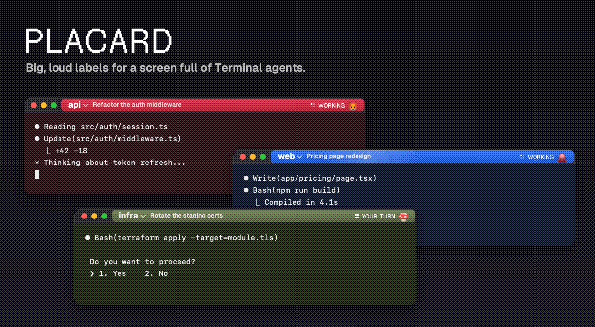

<p align="center">
  
</p>

<h1 align="center">Placard</h1>

<p align="center"><b>Big, loud labels for a screen full of Terminal agents.</b><br>
Ten Claude Code windows open, all named <code>-zsh</code>? Placard puts a colored name in every title bar, tells you which agent is working and which one is waiting on you, and makes the window go off when it needs your approval.</p>

---

## What it does

- **A name you can read from across the room.** A colored strip lives inside each Terminal title bar: group name, the task Claude is on, and a status. It never covers a line of output.
- **Live agent status.** `WORKING` strips are bright with a slow sweep of light. Finished agents dim to `YOUR TURN`. Status comes from Claude Code's own title spinner, read once a second.
- **Christmas mode.** When an agent shows a permission or question prompt, the whole window, background and every letter, cycles red, green and gold until you answer. Impossible to miss on a three-monitor desk.
- **Labels itself.** Start talking to an agent and its window gets a label. If the task title names a group you already have ("fix the api tests"), it joins that group.
- **Colors that never clash.** Eight colors spread out in OKLab space. A new group takes the color farthest from every group already open, and two open groups never end up red next to orange.
- **Groups act as bundles.** Bring a whole group to the front, or tile it across one screen, from the dropdown or a hotkey.
- **One emoji per agent.** Each window gets its own random emoji, unique across the screen, beside the status.

## Install

Needs macOS 14 or later and the Xcode command line tools. No Xcode project, no dependencies.

```sh
git clone https://github.com/karimbabasf/placard.git
cd placard
./build.sh --install
```

That builds `Placard.app`, copies it to `~/Applications`, puts the `placard` command in `~/.local/bin`, adds it to login items and starts it. On first launch macOS asks once whether Placard may control Terminal. Say yes: that is how it reads titles and tints windows.

## Use it

| To | Do |
|---|---|
| Label a window | Click the `+` at the right end of its title bar, or press `⌃⌥L` |
| Rename a group | Click the name on the strip |
| Rename a task | Click the task text on the strip (empty goes back to the Terminal title) |
| Open the window menu | Click the chevron, or right-click the strip |
| Bring a group to front | `⌃⌥1` to `⌃⌥9`, or the menu |
| Tile a group on one screen | `⌃⌥T` |
| Remove a label | `⌃⌥U`, or the menu |
| Hide every label | Menu: Show Labels. A small handle stays on each window so you can turn them back on |

From a shell, the `placard` command labels the window it runs in:

```sh
placard api            # label this window "api" (joins the group if it exists)
placard api blue       # with a color
placard -u             # remove this window's label
placard -r api         # bring group "api" to front
placard -t api         # tile group "api"
```

Every action is also a URL, handy for scripts and hooks:

```sh
open -g "placard://label?name=api&tty=$(tty)"
open -g "placard://raise?name=api"
```

## How it works

Placard is about 2,400 lines of Swift and AppKit, built with plain `swiftc`.

- **Strips are their own windows,** floating above Terminal and masked by every window in front of it, so clicking a Terminal window can never hide its label. The mask is a `CGPath` subtraction recomputed only when the z-order changes.
- **Z-order is cheap to watch.** Every frame Placard reads the bare window id list from `CGWindowListCreate`, which is hidden from Swift and loaded with `dlsym`. Full window scans run only when that list changes, while you drag, or twice a second. Around activity it runs at 60 Hz, otherwise 15 Hz, at about 2% of one core.
- **Terminal speaks AppleScript.** One `osascript` call a second reads every window's title, busy flag and colors. Claude Code puts a spinner in the title while it works and `✳` when it waits. A prompt on screen ("Do you want to proceed?", "Enter to select") turns waiting into needs-you.
- **Nothing outside your Mac.** No network, no telemetry. State lives in `~/Library/Application Support/Placard/state.json`, logs in `~/Library/Logs/Placard.log`.

## Test it

```sh
./build.sh && open build/Placard.app
osascript -e 'tell application "Terminal" to get id of every window'
open -g "placard://label?window=<id>&name=Test"
```

The hero above is rendered by code, not recorded. `docs/make-hero.sh` draws the frames in `docs/hero.swift`, runs the strips through a 4x4 Bayer dither, and encodes the GIF with ffmpeg.

## Limits

- Terminal.app only. iTerm2 and Ghostty have their own scripting and would need their own reader.
- Terminal gives windows new ids when it relaunches, so labels survive a Placard restart but not a Terminal restart.
- The build is ad-hoc signed, so macOS may ask about Terminal control again after a rebuild.

Fonts: [Geist and Geist Pixel](https://github.com/vercel/geist-font) by Vercel, bundled under the SIL Open Font License (`Resources/Fonts/OFL.txt`).
